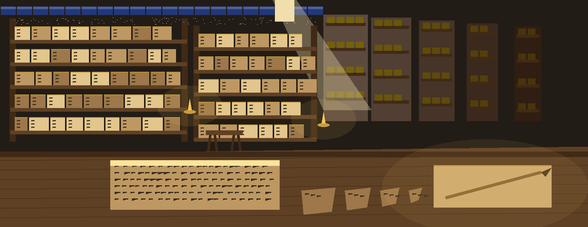
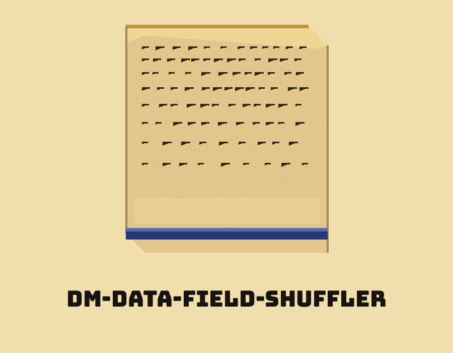
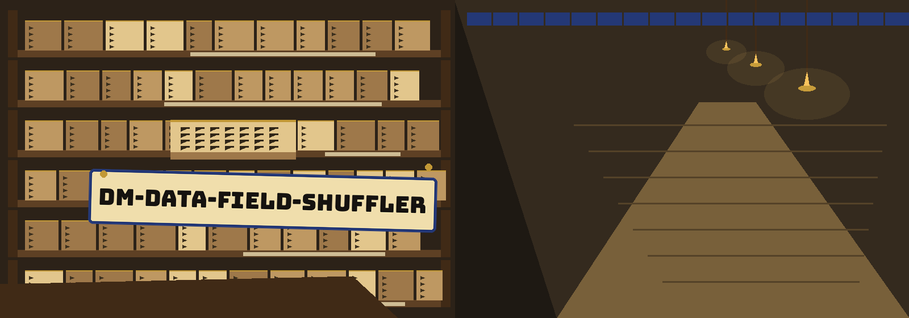
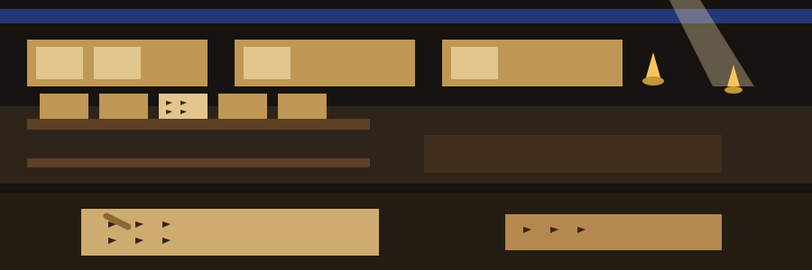

# dm-data-field-shuffler

Title block: the name above is set in Bungee Tint in kohl black on a pale papyrus plate, with a lapis rule under it and a small tablet mark at the left of the first heading only.

# dm-data-field-shuffler
Shuffles the order of fields within each data record. This breaks simple field-order-dependent attacks and analysis without altering the individual field values. - Focused on Tools designed to generate or mask sensitive data with realistic-looking but meaningless values

## Install
`git clone https://github.com/ShadowGuard-AI/dm-data-field-shuffler`

## Usage
`python3 main.py input_file output_file [options]`

Naming the output file as the input file is refused at exit 1 before any file is opened. An empty input file exits 1 with the line `Input file is empty.`, whether or not the header flag is given, and writes no output.

> Catalogue slip: same name output is refused before opening.

> Catalogue slip: empty input writes nothing.

## Parameters
- `-h`: Show help message and exit
- `-H`: Treat the first row as a header and preserve it.

> Catalogue slip: the README names no seed, so no caller should expect a repeatable order from anything written here.

## License
This project is released under the MIT License. See the [LICENSE](LICENSE) file for details.

## Catalogue slips gathered on the shelf walk

The main action button of this re-skin reads Shuffle the Field Order. Its header toggle label reads Keep the First Row as Header. Its headings read Order Changes, Values Do Not, Refused Before Opening, and Nothing Written from an Empty File. At the close, the tablet goes back into a gap that is not the gap it left, the lamp is trimmed, and the catalogue of the room is left accurate about everything except position, which is the point of the tool retold as shelving.
